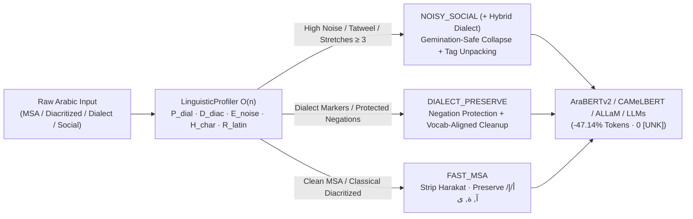

<div align="center">

# مِسار — Misar

**Adaptive $O(n)$ Context-Aware Arabic NLP Preprocessing Router for Transformer Language Models**  
**الموجّه اللغوي التكيفي لتعزيز كفاءة ودقة معالجة اللغة العربية في نماذج الذكاء الاصطناعي**

[](https://github.com/RealMtrx/misar/actions/workflows/ci.yml)
[](https://www.python.org/downloads/)
[](#installation)
[](LICENSE)
[](#empirical-benchmarks)
[](#empirical-benchmarks)

[Architecture](#architecture) • [Benchmarks](#empirical-benchmarks) • [Installation](#installation) • [Quick Start](#quick-start) • [CLI & Workbench](#cli--web-workbench) • [Citation](#citation) • [النسخة العربية](#-نظرة-عامة-بالعربية)

<br/>


</div>

---

## Why Misar?

Modern Arabic NLP deployments face a structural bottleneck: forcing heterogeneous Arabic text (**Modern Standard Arabic**, **classical diacritized prose**, **Gulf/Egyptian/Levantine/Maghrebi dialects**, and **noisy social media**) through a single static preprocessing pipeline actively degrades both accuracy and inference economics:

1. **Legacy Normalization Damages Modern Transformers:** Classical regex pipelines blindly collapse `ة → ه` and `أ/إ/آ → ا`. However, modern Transformer vocabularies such as **AraBERTv2** (`64k` WordPiece) and **CAMeLBERT** explicitly preserve Hamzas and Taa Marbuta—meaning legacy normalization shatters known whole words (e.g., `الهيئة` as `1` token splits into `الهي` + `##ئه` as `2` tokens).
2. **Dialectal Sentiment & Negation Erasure:** Over-aggressive cleaning distorts critical colloquial negation and sentiment markers (`مو`, `مش`, `مفيش`, `ماكو`), reversing downstream classification polarity.
3. **Diacritic, Tatweel & Elongation Token Explosion:** Unstripped harakat (`تشكيل`), kashida (`ـ`), and character stretches (`سيييييء`, `السلاممممم`) trigger OOV `[UNK]` blindness or inflate subword token counts—multiplying Transformer $O(L^2)$ self-attention cost and API billing.

**Misar (`مِسار`)** solves all three challenges **without retraining any model (`Zero Parameter Update`)** by acting as an ultra-lightweight, zero-dependency, linear-time $O(n)$ routing gateway directly in front of your Transformer or LLM pipeline.

---

## Architecture

Every incoming text passes once through `LinguisticProfiler` (`< 0.25 ms` on CPU) to compute five quantitative signals (`dialect_ratio` $P_{\text{dial}}$, `diacritic_density` $D_{\text{diac}}$, `elongation_noise_score` $E_{\text{noise}}$, character Shannon Entropy $H_{\text{char}}$, and `code_switching_ratio` $R_{\text{latin}}$), then dispatches dynamically to the optimal micro-pipeline:



---

## Empirical Benchmarks

Measured reproducibly via `python benchmarks/run_benchmark.py` against the authentic **64,000-token `aubmindlab/bert-base-arabertv02` WordPiece vocabulary** across 15 curated multi-domain samples ([`latest_benchmark_report.json`](benchmarks/latest_benchmark_report.json)):

| Domain Category | Samples | Raw Tokens | Legacy Static (`ة→ه`, `أ→ا`) | **Misar Adaptive** | Misar Gain vs. Raw |
| :--- | :---: | :---: | :---: | :---: | :---: |
| **MSA Official Press** | 3 | 46 | 63 *(+37% fragmentation)* | **46** | Preserves `100%` orthography (`-27.0%` vs Legacy) |
| **Classical Diacritized** | 3 | 132 *(94 overhead/OOV)* | 33 | **32** | **`-75.8%`** tokens & **`100%`** word recovery (`0 [UNK]`) |
| **Gulf / Egyptian / Levantine / Maghrebi** | 6 | 86 | 94 | **83** | **`-3.5%`** tokens (`-11.7%` vs Legacy) + negations intact |
| **Noisy Social Media & Stretches** | 3 | 86 | 66 | **24** | **`-72.1%`** tokens + gemination preserved |
| **Full Corpus Summary** | **15** | **350** | **256** | **185** | **`-47.14%` vs Raw · `-27.73%` vs Legacy · `0.202 ms/text`** |

> **Key Scientific Proof:** On Standard Arabic press releases (`MSA Official`), blind legacy normalization inflated token count from **46 → 63** due to `ة → ه` subword splitting, while Misar maintained **46** intact vocabulary tokens (`TFR ≈ 1.0`). Across all 15 multi-domain inputs, Misar saved **47.14%** of total tokens vs. raw text and **27.73%** vs. legacy normalization with **0.202 ms** mean latency on pure CPU.

---

## Installation

Core `misar` requires **zero mandatory external packages** (Python `3.9+` Standard Library only):

```bash
# Install directly from GitHub
pip install git+https://github.com/RealMtrx/misar.git

# Or from PyPI once published
pip install misar
```

Optional extras for live Hugging Face Transformers wrapping and package development:

```bash
pip install "misar[huggingface]"   # transformers + torch
pip install "misar[dev]"           # pytest + build + twine
```

*(Note: On first use of the built-in `WordPieceTokenizer`, Misar caches the official 64k vocabulary file locally under `~/.cache/misar/`. Pass `allow_vocab_download=False` or `--offline` to run completely air-gapped using `HeuristicSubwordTokenizer`.)*

---

## Quick Start

### 1. Dynamic Text Routing & Token Telemetry

```python
from misar import MisarRouter

router = MisarRouter()  # Uses real AraBERTv2 64k WordPiece vocabulary

result = router.route("المطعممممم سيييييء جداااااا ومفيش أسلوب خالصصصصص 😡😡😡👎 #تجربة_فاشلة")

print("Route:     ", result.route_name)          # NOISY_SOCIAL
print("Processed: ", result.processed_text)      # المطعم سيء جدا ومفيش أسلوب خالص تجربة فاشلة
print("Tokens:    ", result.raw_token_count, "->", result.processed_token_count)  # 24 -> 9
print("Reduction: ", f"-{result.token_reduction_pct:.1f}%")                       # -62.5%
print("Latency:   ", f"{result.latency_ms:.3f} ms")
```

### 2. Zero-Latency Drop-In String Preprocessing & Batching

```python
from misar import MisarRouter, preprocess

# One-line module helper
clean = preprocess("الســــلام علــــيكم ومفيش مشكلة #مبادرة_وطنية")
# -> "السلام عليكم ومفيش مشكلة مبادرة وطنية"

# Fast batch routing for production ETL pipelines
router = MisarRouter()
results = router.route_batch([
    "أصدرت عدة دول عربية بياناً مشتركاً لأول مرة عن صافي الأرباح",  # -> FAST_MSA (zero dialect false positives)
    "والللله المكان مو حلو أبداً والخدمة متكررررة",                  # -> NOISY_SOCIAL (preserves والله and مو)
])
```

### 3. One-Line Hugging Face Transformers Integration

```python
from transformers import pipeline
from misar import MisarRouter

sentiment = pipeline("sentiment-analysis", model="CAMeL-Lab/bert-base-arabic-camelbert-mix-sentiment")
smart_sentiment = MisarRouter(tokenizer=sentiment.tokenizer).wrap_hf_pipeline(sentiment)

print(smart_sentiment("المكان مو حلو أبداً والمطعمممم سييييء #فاشل"))
```

---

## CLI & Web Workbench

Misar includes a clean command-line interface and a self-hosted HTTP server + Arabic RTL Interactive Workbench:

```bash
# Run 6 built-in cross-dialect samples with live AraBERTv2 tokenization
misar demo

# Route a single sentence and inspect JSON telemetry
misar route "أعلنت الهيئة السعودية للبيانات والذكاء الاصطناعي عن مبادرات وطنية" --json

# Run the reproducible 15-sample benchmark suite
misar bench

# Launch the interactive RTL Web Workbench & hardened REST API on http://127.0.0.1:8050
misar serve
```

### Embedded REST API Endpoints (`misar serve`)

| Method | Endpoint | Description |
| :--- | :--- | :--- |
| `GET` | `/api/health` | Service status, version, and active tokenizer backend |
| `GET` | `/api/suite` | Evaluates the 6 standard cross-domain reference samples |
| `POST` | `/api/route` | Body `{"text": "..."}` → Returns full `RoutingResult` telemetry |
| `POST` | `/api/batch` | Body `{"texts": ["...", "..."]}` → Batch routes up to 500 strings (`1 MiB` payload limit) |

---

## Repository Structure

```text
misar/
├── .github/workflows/ci.yml           # Cross-OS Python 3.9–3.13 CI pipeline
├── docs/misar-architecture.png        # High-resolution system architecture diagram
├── benchmarks/
│   ├── run_benchmark.py               # Reproducible benchmark runner
│   └── latest_benchmark_report.json   # Verified telemetry snapshot
├── src/misar/
│   ├── __init__.py                    # Public API exports
│   ├── profiler.py                    # O(n) 5-signal LinguisticProfiler & Shannon entropy
│   ├── lexicons.py                    # MSA-safe multi-region dialect & negation lexicons
│   ├── pipelines.py                   # FAST_MSA, DIALECT_PRESERVE & NOISY_SOCIAL passes
│   ├── tokenizer.py                   # Pure-Python WordPieceTokenizer + HF & offline adapters
│   ├── router.py                      # MisarRouter orchestration & wrap_hf_pipeline
│   ├── benchmark.py                   # Shared benchmark suite module
│   ├── cli.py                         # `misar` CLI (`demo`, `route`, `bench`, `serve`)
│   └── web/
│       ├── server.py                  # Hardened zero-dependency ThreadingHTTPServer REST API
│       └── index.html                 # Interactive Arabic RTL Workbench & token visualizer
├── tests/test_misar.py                # 23 unit, security, server & real-vocab tests
├── CITATION.cff                       # Native GitHub repository citation metadata
├── CONTRIBUTING.md                    # Developer setup & contribution standards
├── SECURITY.md                        # Built-in API & frontend hardening controls
├── CHANGELOG.md                       # Formal release history
├── LICENSE                            # MIT License
└── pyproject.toml                     # PEP 621 PyPI package specification
```

---

## Testing & Verification

```bash
python -m unittest discover -s tests -v
```

All **23 automated tests** verify profiler mathematics, MSA homograph false-positive resistance, Saudi/Egyptian/Levantine/Maghrebi negation preservation, gemination protection (`والللله → والله`), markdown stripping, tatweel/diacritic splitting, authentic `AraBERTv2` WordPiece reduction, and REST server HTTP security bounds.

---

## Citation

If you use **Misar** in academic research, benchmarks, or commercial NLP pipelines, please cite:

```bibtex
@software{altheeb2026misar,
  author       = {Muneer Jarab Matrak Al-Theeb},
  title        = {Misar (مِسار): Adaptive Context-Aware Arabic NLP Preprocessing Router for Transformer Language Models},
  year         = {2026},
  version      = {1.0.0},
  url          = {https://github.com/RealMtrx/misar},
  license      = {MIT}
}
```

---

## 📖 نظرة عامة بالعربية

**مِسار (`Misar`)** هي مكتبة وموجّه بايثون مفتوح المصدر وخفيف الوزن (بلا أي تبعيات خارجية إجبارية) صُمِّم ليعمل كطبقة بوابة ذكية في زمن خطي $O(n)$ (**~0.20 مللي ثانية** للنص) قبل نماذج المحولات اللغوية العربية مثل `AraBERTv2` و `CAMeLBERT` والنماذج التوليدية (`ALLaM` و `LLMs`) **دون الحاجة إلى إعادة تدريب النموذج (`Zero Parameter Update`)**.

* **توجيه ثلاثي المسارات:** يفحص النص في تمريرة واحدة ويختار بين مسار الفصحى الحافظ للإملاء (`FAST_MSA`)، أو مسار حفظ اللهجة وأدوات النفي (`DIALECT_PRESERVE`) لحماية كلمات مثل `مو، مش، مفيش`، أو مسار تنقية ضجيج شبكات التواصل (`NOISY_SOCIAL`) الذي يضغط المدود والتطويل مع الحفاظ على الكلمات المشددة (`والللله ← والله`).
* **توفير التوكنات وتكاليف الـ APIs:** أظهرت التجارب المرجعية الموثقة على معجم `AraBERTv2` خفض إجمالي التوكنات بنسبة **47.14%** مقارنة بالنص الخام و**27.73%** مقارنة بمناهج التطبيع القديمة، مع استعادة **100%** من الكلمات المتأثرة بالتشكيل والكشيدة (`0 [UNK]`).

---

<div align="center">

Authored and maintained by **Muneer Jarab Matrak Al-Theeb (منير جراب مترك الذيب)**  
Released under the [MIT License](LICENSE) © 2026

</div>
