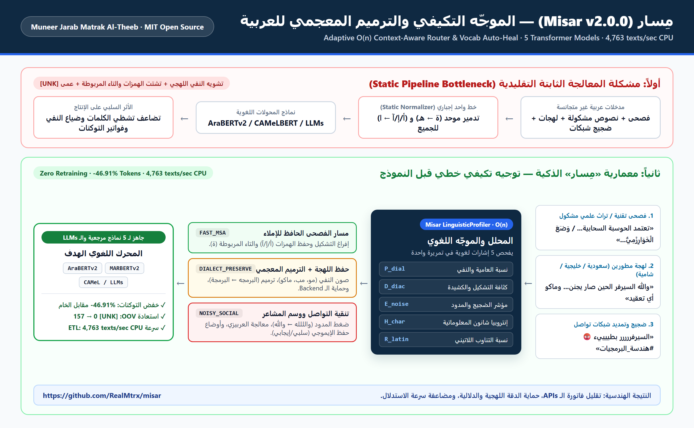
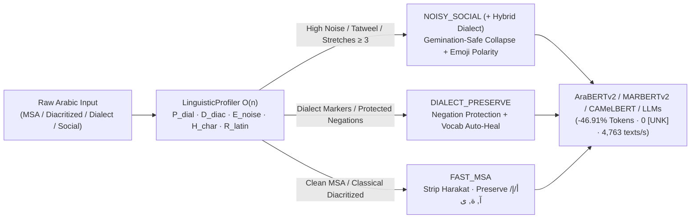

<div align="center">

# مِسار — Misar

**Adaptive $O(n)$ Context-Aware Arabic NLP Preprocessing Router for Transformer Language Models**  
**الموجّه اللغوي التكيفي لتعزيز كفاءة ودقة معالجة اللغة العربية في نماذج الذكاء الاصطناعي**

[](https://pypi.org/project/misar/)
[](https://github.com/RealMtrx/misar/actions/workflows/ci.yml)
[](https://www.python.org/downloads/)
[](#installation)
[](https://github.com/RealMtrx/misar/blob/main/LICENSE)
[](#empirical-benchmarks)
[](#empirical-benchmarks)
[](#empirical-benchmarks)

[Architecture](#architecture) • [Benchmarks](#empirical-benchmarks) • [Installation](#installation) • [Quick Start](#quick-start) • [CLI & Workbench](#cli--web-workbench) • [Citation](#citation) • [النسخة العربية](#-نظرة-عامة-بالعربية)

<br/>



</div>

---

## Why Misar?

Modern Arabic NLP deployments face a structural bottleneck: forcing heterogeneous Arabic text (**Modern Standard Arabic**, **classical diacritized prose**, **Gulf/Egyptian/Levantine/Maghrebi dialects**, and **noisy social media**) through a single static preprocessing pipeline actively degrades both accuracy and inference economics:

1. **Legacy Normalization Damages Modern Transformers:** Classical regex pipelines blindly collapse `ة → ه` and `أ/إ/آ → ا`. However, modern Transformer vocabularies such as **AraBERTv2** (`64k` WordPiece) and **CAMeLBERT** explicitly preserve Hamzas and Taa Marbuta—meaning legacy normalization shatters known whole words (e.g., `الحوسبة` as `1` token splits into `الحو` + `##سبه` as `2` tokens).
2. **Dialectal Sentiment & Negation Erasure:** Over-aggressive cleaning distorts critical colloquial negation and sentiment markers (`مو`, `مب`, `مافيه`, `ماكو`), reversing downstream classification polarity.
3. **Diacritic, Tatweel & Elongation Token Explosion:** Unstripped harakat (`تشكيل`), kashida (`ـ`), and character stretches (`بطييييء`, `السيرفررررر`) trigger OOV `[UNK]` blindness or inflate subword token counts—multiplying Transformer $O(L^2)$ self-attention cost and API billing.

**Misar (`مِسار`)** solves these bottlenecks **without retraining any model (`Zero Parameter Update`)** by acting as an ultra-lightweight, zero-dependency, linear-time $O(n)$ routing gateway directly in front of **AraBERTv2, MARBERTv2, CAMeLBERT-Mix, ARBERTv2, QARiB**, or generative LLMs.

### How Misar v2.0 Compares to Existing Arabic Preprocessors

| Capability | `ArabertPreprocessor` | `tnkeeh` | `CAMeL Tools` | **Misar v2.0 (`مِسار`)** |
| :--- | :---: | :---: | :---: | :---: |
| **Dynamic $O(n)$ Per-Text Routing** | Static pipeline | Static pipeline | Manual utilities | **Automatic 3-route profiling** |
| **Zero Mandatory Dependencies** | Requires `pyarabic` / extras | Light deps | Heavy ML / data packs | **100% Pure Python Stdlib** |
| **Vocab-Verified Auto-Heal (`ة`/`ه`)** | Collapses `ة→ه` blindly | Optional regex | Separate disambig | **$O(1)$ Pronoun-Safe Vocab Repair** |
| **5 Arabic Transformer Vocabs (`do_lower_case`)** | AraBERT focus | Generic | General NLP | **AraBERTv2, MARBERTv2, ARBERTv2, CAMeLBERT, QARiB** |
| **Emoji Polarity Modes & Code-Switch Clitics** | Strip / Placeholders | Strip | Strip | **Strip / Keep / Sentiment Tag + `الـAPI` Fix** |
| **3-Way Scientific Web Workbench + REST API** | — | — | CLI only | **Built-in Live Comparator UI (`Raw` vs `Legacy` vs `Misar`)** |

---

## Architecture

Every incoming text passes once through `LinguisticProfiler` (`< 0.25 ms` on CPU) to compute five quantitative signals (`dialect_ratio` $P_{\text{dial}}$, `diacritic_density` $D_{\text{diac}}$, `elongation_noise_score` $E_{\text{noise}}$, character Shannon Entropy $H_{\text{char}}$, and `code_switching_ratio` $R_{\text{latin}}$), then dispatches dynamically to the optimal micro-pipeline:



---

## Empirical Benchmarks

Measured reproducibly via `python benchmarks/run_benchmark.py` against the authentic **64,000-token `aubmindlab/bert-base-arabertv02` WordPiece vocabulary** across 15 curated multi-domain samples ([`latest_benchmark_report.json`](https://github.com/RealMtrx/misar/blob/main/benchmarks/latest_benchmark_report.json)):

| Domain Category | Samples | Raw Tokens | Fair Legacy Static (`ة→ه`, `أ→ا`) | **Misar v2.0** | Misar Gain |
| :--- | :---: | :---: | :---: | :---: | :--- |
| **MSA Engineering & Code-Switch** | 3 | 57 | 79 *(+38.6% fragmentation)* | **57** | Preserves `100%` orthography (**`-27.85%`** vs Legacy) |
| **Classical Diacritized (Heritage)** | 3 | 186 *(147 OOV `[UNK]`)* | 48 | **39** | **`-79.03%`** vs Raw · **`-18.75%`** vs Legacy (`0 [UNK]`) |
| **Saudi / Gulf / Levantine / Maghrebi Dev** | 6 | 124 | 131 | **117** | **`-5.65%`** vs Raw · **`-10.69%`** vs Legacy (+ Auto-Heal & Negations) |
| **Noisy Tech Social & Code-Switching** | 3 | 102 | 40 | **36** | **`-64.71%`** vs Raw · **`-10.00%`** vs Legacy + gemination intact |
| **Full Corpus Summary** | **15** | **469** | **298** | **249** | **`-46.91%` vs Raw · `-16.44%` vs Fair Legacy · `4,763 texts/s`** |

> **Key Scientific Proof:** Even when competing against an identical full-denoising Legacy Static baseline (`URL/Emoji/Hashtag/Stretch removal + ة→ه, أ→ا`), Misar v2.0 still saves **16.44%** fewer tokens than Legacy Static (**46.91%** vs Raw), eliminates **`157 → 0 [UNK]`** tokens, repairs broken orthography (`Auto-Heal`), preserves dialectal negations, and streams at **4,763 texts/sec** on CPU.

---

## Installation

Core `misar` requires **zero mandatory external packages** (Python `3.9+` Standard Library only):

```bash
# Install directly from GitHub
pip install git+https://github.com/RealMtrx/misar.git

# Or from PyPI once published
pip install misar
```

Optional extras for live Hugging Face Transformers wrapping and package development:

```bash
pip install "misar[huggingface]"   # transformers + torch
pip install "misar[dev]"           # pytest + build + twine
```

*(Note: On first use of the built-in `WordPieceTokenizer`, Misar caches the official 64k vocabulary file locally under `~/.cache/misar/`. Pass `allow_vocab_download=False` or `--offline` to run completely air-gapped using `HeuristicSubwordTokenizer`.)*

---

## Quick Start

### 1. Dynamic Text Routing & Token Telemetry

```python
from misar import MisarRouter

router = MisarRouter()  # Uses real AraBERTv2 64k WordPiece vocabulary

result = router.route("السيرفررررر بطييييء مررررة ومافيه استجابة في API أبدددداً 😡😡👎 #هندسة_البرمجيات")

print("Route:     ", result.route_name)          # NOISY_SOCIAL
print("Processed: ", result.processed_text)      # السيرفر بطيء مرة ومافيه استجابة في API أبدا هندسة البرمجيات
print("Tokens:    ", result.raw_token_count, "->", result.processed_token_count)  # 28 -> 14
print("Reduction: ", f"-{result.token_reduction_pct:.1f}%")                       # -50.0%
print("Latency:   ", f"{result.latency_ms:.3f} ms")
```

### 2. Zero-Latency ETL Batching, `Auto-Heal`, Sentiment Emoji & Hugging Face `datasets`

```python
from misar import MisarRouter, preprocess, preprocess_batch

# One-line module helpers
clean = preprocess("الســــلام علــــيكم ومافيه مشكلة #تطوير_البرمجيات")
# -> "السلام عليكم ومافيه مشكلة تطوير البرمجيات"

# MARBERTv2 social mode: preserves sentiment emojis as 1-token tags + vocab-verified Auto-Heal + Clitics
router = MisarRouter(model_key="marbertv2", emoji_mode="sentiment", auto_heal=True)
comp = router.compare_baselines("ياخي البرمجه في المنصه هاذي بطييييئه 😡😡 في الـ Backend")
print("Processed:", comp["misar"]["processed_text"])
print("vs Legacy:", f"{comp['vs_legacy_reduction_pct']:+.1f}%")

# Fast streaming batch preprocessing & Hugging Face Datasets .map(..., batched=True)
cleaned_list = router.preprocess_batch(["نص أول", "نص ثاااني 😡"])
# dataset = dataset.map(router.hf_dataset_map, batched=True)
```

### 3. One-Line Hugging Face Transformers Integration

```python
from transformers import pipeline
from misar import MisarRouter

sentiment = pipeline("sentiment-analysis", model="CAMeL-Lab/bert-base-arabic-camelbert-mix-sentiment")
smart_sentiment = MisarRouter(tokenizer=sentiment.tokenizer).wrap_hf_pipeline(sentiment)

print(smart_sentiment("الكود مو معقد أبداً بس السيرفررررر بطييييء #مشكلة"))
```

---

## CLI & Web Workbench

Misar includes a clean command-line interface and a self-hosted HTTP server + Arabic RTL Interactive Workbench:

```bash
# Run 6 built-in cross-dialect samples with live AraBERTv2 tokenization
misar demo

# Route a sentence and compare Raw vs Legacy Static vs Misar side-by-side
misar route "ياخي البرمجه في المنصه هاذي بطيييئة 😡 في الـ Backend" --compare --emoji-mode sentiment

# Select target model vocab (arabertv02, camelbert-mix, marbertv2, arbertv2, qarib)
misar route "أعلنت منصة المطورين عن ترقية واجهة البرمجة API" --model marbertv2 --json

# Run the reproducible 15-sample benchmark suite
misar bench

# Launch the interactive RTL Web Workbench & hardened REST API on http://127.0.0.1:8050
misar serve
```

### Embedded REST API Endpoints (`misar serve`)

| Method | Endpoint | Description |
| :--- | :--- | :--- |
| `GET` | `/api/health` | Service status, version, and active tokenizer backend |
| `GET` | `/api/suite` | Evaluates the 6 standard cross-domain reference samples |
| `POST` | `/api/route` | Body `{"text": "..."}` → Returns full `RoutingResult` telemetry |
| `POST` | `/api/batch` | Body `{"texts": ["...", "..."]}` → Batch routes up to 500 strings (`1 MiB` payload limit) |

---

## Repository Structure

```text
misar/
├── .github/workflows/ci.yml           # Cross-OS Python 3.9–3.13 CI pipeline
├── docs/misar-architecture.png        # High-resolution system architecture diagram
├── benchmarks/
│   ├── run_benchmark.py               # Reproducible benchmark runner
│   └── latest_benchmark_report.json   # Verified telemetry snapshot
├── src/misar/
│   ├── __init__.py                    # Public API exports
│   ├── profiler.py                    # O(n) 5-signal LinguisticProfiler & Shannon entropy
│   ├── lexicons.py                    # MSA-safe multi-region dialect & negation lexicons
│   ├── pipelines.py                   # FAST_MSA, DIALECT_PRESERVE & NOISY_SOCIAL passes
│   ├── tokenizer.py                   # Pure-Python WordPieceTokenizer + HF & offline adapters
│   ├── router.py                      # MisarRouter orchestration & wrap_hf_pipeline
│   ├── benchmark.py                   # Shared benchmark suite module
│   ├── cli.py                         # `misar` CLI (`demo`, `route`, `bench`, `serve`)
│   └── web/
│       ├── server.py                  # Hardened zero-dependency ThreadingHTTPServer REST API
│       └── index.html                 # Interactive Arabic RTL Workbench & token visualizer
├── tests/test_misar.py                # 32 unit, v2 feature, server & real-vocab tests
├── CITATION.cff                       # Native GitHub repository citation metadata
├── CONTRIBUTING.md                    # Developer setup & contribution standards
├── SECURITY.md                        # Built-in API & frontend hardening controls
├── CHANGELOG.md                       # Formal release history
├── LICENSE                            # MIT License
└── pyproject.toml                     # PEP 621 PyPI package specification
```

---

## Testing & Verification

```bash
python -m unittest discover -s tests -v
```

All **32 automated tests** verify profiler mathematics, MSA homograph false-positive resistance, Saudi/Gulf/Levantine/Maghrebi negation preservation, gemination protection (`والللله → والله`), pronoun-safe Vocab Auto-Heal (`البرمجه → البرمجة` while protecting `بيته/ملفه/مديره`), clitic code-switching (`الـ Backend → الBackend`), `do_lower_case` parity for `MARBERTv2`/`ARBERTv2`, opt-in Arabizi tech safety, fast batch/HF dataset mapping, and hardened REST server HTTP security bounds.

---

## Citation

If you use **Misar** in academic research, benchmarks, or commercial NLP pipelines, please cite:

```bibtex
@software{altheeb2026misar,
  author       = {Muneer Jarab Matrak Al-Theeb},
  title        = {Misar (مِسار): Adaptive Context-Aware Arabic NLP Preprocessing Router for Transformer Language Models},
  year         = {2026},
  version      = {2.0.0},
  url          = {https://github.com/RealMtrx/misar},
  license      = {MIT}
}
```

---

## 📖 نظرة عامة بالعربية

**مِسار (`Misar v2.0.0`)** هي مكتبة وموجّه بايثون مفتوح المصدر وخفيف الوزن (بلا أي تبعيات خارجية إجبارية) صُمِّم ليعمل كطبقة بوابة ذكية في زمن خطي $O(n)$ (**~0.24 مللي ثانية** للنص وبسرعة **4,763 نص/ثانية** في المعالجة الدفعية) قبل نماذج المحولات العربية الخمسة (`AraBERTv2`, `MARBERTv2`, `CAMeLBERT`, `ARBERTv2`, `QARiB`) والنماذج التوليدية (`ALLaM` و `LLMs`) **دون الحاجة إلى إعادة تدريب النموذج (`Zero Parameter Update`)**.

* **توجيه ثلاثي المسارات + الترميم المعجمي (`Vocab Auto-Heal`):** يختار ديناميكياً بين `FAST_MSA` و`DIALECT_PRESERVE` و`NOISY_SOCIAL`، ويرمّم أخطاء التاء المربوطة الشائعة (`البرمجه ← البرمجة`) بالتحقق اللحظي من قاموس النموذج دون المساس بالضمائر (`بيته، ملفه، مديره`)، ويعالج سوابق اللغات المختلطة (`الـ Backend ← الBackend`) مع أوضاع مرنة لحفظ قطبية الإيموجي ودعم العربيزي و`Hugging Face Datasets`.
* **توفير التوكنات وتكاليف الـ APIs:** أظهرت التجارب الموثقة على معجم `AraBERTv2` خفض التوكنات بنسبة **46.91%** مقارنة بالنص الخام و**16.44%** مقارنة بالمناهج التدميرية التقليدية، مع استعادة **100%** من الكلمات المتأثرة بالتشكيل والكشيدة (`157 → 0 [UNK]`).

---

<div align="center">

Authored and maintained by **Muneer Jarab Matrak Al-Theeb (منير جراب مترك الذيب)**  
Released under the [MIT License](https://github.com/RealMtrx/misar/blob/main/LICENSE) © 2026

</div>
